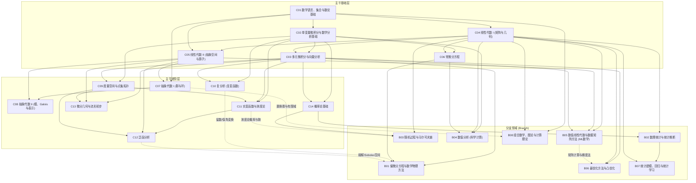

# 参考课程体系与历史素材调研

> 关联工单：[参考课程体系与历史素材调研](../issues/004-curriculum-references.md)  
> 术语约定：遵循 [GLOSSARY.md](../GLOSSARY.md)（知识网、骨架、领域、主题、概念、前置、主干、分支、讲义、历史动机）。

---

## 一、大学数学课程体系与知识网领域/主题拆解

### 1. 一手参考来源（Primary Sources）

1. **MIT Mathematics (Course 18) & MIT OpenCourseWare (OCW)**
   - 本科学位要求（General / Pure / Applied / 18-C）：<https://catalog.mit.edu/degree-charts/mathematics-course-18/>、<https://catalog.mit.edu/degree-charts/mathematics-computer-science-course-18-c/>
   - 官方课程目录与前置规定：<https://catalog.mit.edu/subjects/18/>
   - 数学系本科选课路线图（Stage 1–3）：<https://math.mit.edu/academics/undergrad/roadmaps.html>
   - MIT OCW 课程教学日程（Syllabus & Lecture Calendar）：<https://ocw.mit.edu/courses/mathematics/>（涵盖 `18.01`, `18.02`, `18.03`, `18.06`, `18.065`, `18.100A/B`, `18.102`, `18.112`, `18.330`, `18.335J`, `18.404J`, `18.600`, `18.650`, `18.701`, `18.702`, `18.703`, `18.901`, `18.950`, `15.053`）
2. **剑桥大学数学 Tripos（Cambridge Mathematical Tripos）**
   - 官方教学进度与考试手册（*Schedules of Lecture Courses and Form of Examinations for the Mathematical Tripos*，含每门课精确讲数 12/16/24 讲、逐节提纲与前置课程说明）：<https://www.maths.cam.ac.uk/undergrad/course/schedules.pdf>
   - 本科课程总览（Part IA, Part IB, Part II）：<https://www.maths.cam.ac.uk/undergrad/course/>
3. **普林斯顿大学数学系（Princeton Department of Mathematics）**
   - 本科培养要求（Core 300-level 四大支柱：Real Analysis, Complex Analysis, Algebra, Geometry/Topology/Discrete）：<https://www.math.princeton.edu/undergraduate/requirements>
   - 本科课程列表与导引：<https://www.math.princeton.edu/undergraduate/courses>、<https://ua.princeton.edu/fields-study/department-mathematics>
4. **北京大学数学科学学院 & 复旦大学数学科学学院**
   - 北大数院本科培养方案：<https://www.math.pku.edu.cn/xywh/bkjy/pyfa/index.htm>
   - 北大数院本科常设课程手册（含课程编号 `0013xxxx`、学分与前置说明）：<https://www.math.pku.edu.cn/xywh/bkjy/cscs/index.htm>
   - 复旦数院本科培养方案（课程编号 `MATH130xxx`）：<https://math.fudan.edu.cn/>

---

### 2. 四校体系对比与知识网领域（Field）映射

四校在入门节奏上略有差异（MIT 先修计算型微积分/线代再转入 `18.100`/`18.701` 严格证明；剑桥 Part IA、普林斯顿 `MAT 215`/`217`、北大/复旦“数分+高代+几何”则从大一直接进入严格证明体系），但折算为**知识网（Knowledge Web）**的**领域（Field）**后高度收敛，可归纳为 **14 个主干（Core）领域** 与 **8 个分支（Branch）领域**。

#### A. 主干领域（Core Fields，C01–C14）

| 领域编号与名称 | MIT Course 18 | 剑桥 Tripos (Part IA / IB / II) | 普林斯顿 MAT | 北大数院 / 复旦数院 |
| :--- | :--- | :--- | :--- | :--- |
| **C01. 数学语言、集合与数论基础** | `18.090` / `18.781` (Theory of Numbers) | **IA**: *Numbers and Sets* (24讲) **II**: *Number Theory* (24讲) | `MAT 214` / `MAT 215` 前半 | 《数学分析 I》序章 + 《数论基础》(`00136880`) |
| **C02. 单变量微积分与数学分析基础** | `18.01` + `18.100A` (Real Analysis) | **IA**: *Analysis I* (24讲) | `MAT 215` (Honors Analysis in a Single Variable) | 《数学分析 I, II》(`00132301`/`00132302`) |
| **C03. 多元微积分与向量分析** | `18.02` + `18.100B` 多元微分部分 | **IA**: *Vector Calculus* (24讲) **IB**: *Analysis and Topology* (多元微分) | `MAT 203` / `MAT 300` (Multivariable Analysis) | 《数学分析 III》(`00132303`) |
| **C04. 线性代数 I（矩阵、方程组与几何直观）** | `18.06` (Linear Algebra, 34讲) | **IA**: *Vectors and Matrices* (24讲) | `MAT 202` / `MAT 204` | 《高等代数 I》(`00132321`) + 《几何学》 |
| **C05. 线性代数 II（抽象空间、算子与标准形）** | `18.700` / `18.701` 线性算子部分 | **IB**: *Linear Algebra* (24讲) | `MAT 217` (Honors Linear Algebra) | 《高等代数 II》(`00132323`) |
| **C06. 常微分方程与动力系统初步** | `18.03` (Differential Equations, 33讲) | **IA**: *Differential Equations* (24讲) | `MAT 321` (ODEs) | 《常微分方程》(`00132340`) |
| **C07. 抽象代数 I（群论、环与域初步）** | `18.701` (Algebra I) / `18.703` | **IA**: *Groups* (24讲) **IB**: *Groups, Rings and Modules* (前部) | `MAT 345` (Algebra I) | 《抽象代数》(`00135450`) |
| **C08. 抽象代数 II（模论、Galois 理论与表示论初步）** | `18.702` (Algebra II) | **IB**: *Groups, Rings and Modules* (24讲) **II**: *Galois Theory*, *Representation Theory* | `MAT 346` (Algebra II) | 《代数学 I/II (H)》(`00137971`) + 《群与表示》(`00136870`) |
| **C09. 度量空间与点集拓扑（含基本群初步）** | `18.100A/B` + `18.901` (Intro to Topology) | **IB**: *Analysis and Topology* (24讲) **II**: *Algebraic Topology* | `MAT 365` (Topology) | 《拓扑学》(`00130161`) |
| **C10. 复分析（复变函数）** | `18.112` (Functions of a Complex Variable) | **IB**: *Complex Analysis* (16讲) / *Complex Methods* | `MAT 330` (Complex Analysis) | 《复变函数》(`00137993`) |
| **C11. 实变函数与测度论** | `18.100B/P` + `18.125` (Measure & Integration) | **II**: *Probability and Measure* (前半测度论) | `MAT 320` (Introduction to Real Analysis) | 《实变函数》(`00132370`) |
| **C12. 泛函分析** | `18.102` (Intro to Functional Analysis) | **II**: *Linear Analysis* (24讲) | `MAT 320` 后半 / `MAT 425` | 《泛函分析》(`00132350`) |
| **C13. 微分几何与流形初步** | `18.950` (Differential Geometry) | **IB**: *Geometry* (12讲) **II**: *Differential Geometry* (24讲) | `MAT 350` (Differential Manifolds) / `MAT 355` | 《微分几何》(`00132310`) + 《微分流形》(`00130190`) |
| **C14. 概率论基础** | `18.600` (Probability and Random Variables) | **IA**: *Probability* (24讲) **II**: *Probability and Measure* (后半) | `MAT 385` (Probability Theory) | 《概率论》(`00131300`) |

#### B. 分支领域（Branch Fields，B01–B08，面向应用/CS/ML/统计/计算）

| 领域编号与名称 | MIT Course 18 / Cross-listed | 剑桥 Tripos (Part IB / II) | 普林斯顿 (MAT / COS / ORF) | 北大数院 / 复旦数院 |
| :--- | :--- | :--- | :--- | :--- |
| **B01. 偏微分方程与数学物理方法** | `18.152` (Intro to PDEs) / `18.303` | **IB**: *Methods* (24讲) + *Variational Principles* (12讲) | `MAT 322` (Partial Differential Equations) | 《偏微分方程》(`00132330`) |
| **B02. 数理统计与统计推断** | `18.650` (Statistics for Applications) | **IB**: *Statistics* (16讲) **II**: *Principles of Statistics* (24讲) | `ORF 245` / `MAT 380` | 《数理统计》(`00135460`) |
| **B03. 随机过程与马尔可夫链** | `18.615` (Intro to Stochastic Processes) | **IB**: *Markov Chains* (12讲) **II**: *Applied Probability* (24讲) | `ORF 309` / `MAT 385` | 《应用随机过程》(`00133090`) |
| **B04. 数值分析（科学计算与微分方程数值解）** | `18.330` (Intro to Numerical Analysis) | **IB**: *Numerical Analysis* (16讲) **II**: *Numerical Analysis* (24讲) | `MAT 393` / `COS 323` | 《数值分析》(`00130560`) |
| **B05. 数值线性代数与数据矩阵方法（ML 数学）** | `18.065` (Matrix Methods in Data Analysis, Signal Processing, and ML) + `18.335J` | **IB/II**: *Numerical Analysis* (矩阵计算部分) | `COS 324` / `MAT 393` | 《数值代数》+《机器学习数学基础》 |
| **B06. 最优化方法与凸优化** | `15.053` / `6.7210` (Mathematical Programming) | **IB**: *Optimization* (12讲) **II**: *Optimization and Control* (24讲) | `ORF 363` / `COS 323` | 《最优化方法》(`00130630`) |
| **B07. 统计建模、回归分析与统计学习** | `18.650` 后半 + `18.655` | **II**: *Statistical Modelling* (16讲) | `ORF 350` | 《应用回归分析》+《统计学习》 |
| **B08. 组合数学、图论与计算理论（CS 数学）** | `18.200` (Discrete Applied Math) + `18.404J` (Theory of Computation) | **II**: *Graph Theory* (24讲), *Coding and Cryptography* (24讲), *Automata and Formal Languages* | `MAT 375` (Graph Theory) + `MAT 377` (Combinatorics) | 《组合数学》/《图论》/《离散数学》/《数理逻辑》 |

---

### 3. 领域间典型前置（Prerequisite）关系

综合四校官方先修规定，领域级**前置（Prerequisite）**有向无环图（DAG）如下（实线为核心前置，虚线为进阶/局部主题前置）：

---

### 4. 每个领域的主题（Topic）清单（约 30–60 分钟粒度）

**粒度标定标准**：剑桥 Tripos 每门课为 12–24 讲（每讲 50 分钟），MIT OCW 每门课为 24–36 讲。将大学课堂 1–2 讲的核心内容凝练为知识网中的一个**主题（Topic）**，括号内为该主题下辖的 3–5 个**概念（Concept）**提纲。以下共归纳 **22 个领域、209 个主题**（主干 137 个主题，分支 72 个主题）。

#### 主干领域主题清单（C01–C14，共 137 个主题）

##### C01. 数学语言、集合与数论基础（10 个主题）
1. **命题逻辑与证明方法**（蕴含与量词、逆否命题、反证法、数学归纳法与强归纳法）
2. **集合、关系与映射**（集合运算、单射/满射/双射、逆映射、像与原像）
3. **等价关系与商集**（等价类、集合划分、商映射、容斥原理）
4. **整除与 Euclid 算法**（带余除法、最大公因子、Bézout 等式、线性丢番图方程）
5. **素数与算术基本定理**（唯一分解定理、Euclid 素数无穷性证明、素数分布初探）
6. **同余与模算术**（同余类环 $\mathbb{Z}_n$、线性同余方程、中国剩余定理）
7. **Fermat 小定理、Euler 定理与 Wilson 定理**（Euler $\varphi$ 函数、模幂运算、RSA 公钥密码动机）
8. **原根与二次剩余**（模 $p$ 乘法群的循环性、Legendre 符号、二次互反律）
9. **有理数、无理数与上确界公理**（$\sqrt{2}$ 与 $e$ 的无理性、有序域、上确界公理与 Archimedes 性质）
10. **可数集与不可数集**（基数比较、$\mathbb{Q}$ 的可数性、Cantor 对角线法与 $\mathbb{R}$ 的不可数性、Schröder–Bernstein 定理）

##### C02. 单变量微积分与数学分析基础（14 个主题）
1. **实数完备性与确界原理**（Dedekind 分割/Cauchy 基本列直观、确界存在定理、区间套定理）
2. **数列极限与收敛准则**（$\varepsilon\text{-}N$ 定义、极限四则运算、夹逼定理、单调有界定理与数 $e$）
3. **子列、Bolzano–Weierstrass 定理与 Cauchy 收敛原理**（上下极限 $\limsup/\liminf$、列紧性、实数完备性等价命题）
4. **函数极限与连续函数**（$\varepsilon\text{-}\delta$ 定义、单侧极限、连续函数局部性质、间断点分类）
5. **闭区间上连续函数的整体性质**（介值定理、有界性与最值定理、一致连续性与 Cantor 定理）
6. **导数、微分与求导法则**（切线与瞬时变化率、链式法则、反函数与隐函数求导、高阶导数与 Leibniz 公式）
7. **微分中值定理（Rolle, Lagrange, Cauchy）**（费马引理、三大中值定理、Darboux 导数介值定理）
8. **L'Hôpital 法则、Taylor 公式与凸函数**（Peano/Lagrange 余项 Taylor 定理、极值判别、凸函数与 Jensen 不等式）
9. **Riemann 积分的定义与可积性判别**（Darboux 上下和、振幅与可积充要条件、连续函数与单调函数的可积性）
10. **微积分基本定理与积分计算方法**（变上限积分、Newton–Leibniz 公式、换元积分法、分部积分法、有理函数积分）
11. **反常积分及其收敛性判别**（无穷区间反常积分、无界函数瑕积分、比较判别法、Dirichlet 与 Abel 判别法）
12. **数项级数收敛性**（正项级数比值/根值/积分判别法、交错级数 Leibniz 判别法、绝对收敛与条件收敛、Riemann 重排定理）
13. **函数项级数与一致收敛**（逐点收敛与一致收敛、Weierstrass $M$-判别法、极限与微积分交换次序定理）
14. **幂级数、解析性与 Fourier 级数初步**（收敛半径与 Abel 定理、Taylor 级数展开、三角正交系、Fourier 级数收敛与 Parseval 等式）

##### C03. 多元微积分与向量分析（11 个主题）
1. **$\mathbb{R}^n$ 的欧氏结构、内积与外积**（范数与 Cauchy–Schwarz 不等式、$\mathbb{R}^3$ 叉积与混合积、柱坐标与球坐标）
2. **空间曲线与参数化运动**（弧长参数化、切向量、曲率、速度与加速度分解）
3. **多元函数的极限与连续性**（$\mathbb{R}^n$ 中的开集与闭集、重极限与累次极限、多元连续函数性质）
4. **偏导数、全微分与梯度**（可微性的线性逼近定义、偏导数与可微的关系、方向导数与梯度 $\nabla f$）
5. **复合映射链式法则与 Jacobi 矩阵**（向量值映射的微分、Jacobi 行列式、多元 Taylor 公式）
6. **多元极值、Hessian 矩阵与 Lagrange 乘子法**（无约束极值的二阶充分条件、等式约束极值与 Lagrange 乘子几何意义）
7. **隐函数定理与逆映射定理**（局部可逆性判据、隐函数存在性与求导、流形局部坐标化的基础）
8. **重积分与变量替换公式**（有界域上的二重/三重积分、Fubini 累次积分、Jacobi 行列式变量替换）
9. **曲线积分与保守向量场**（第一型与第二型曲线积分、梯度场、路径无关性与势函数重构）
10. **曲面积分与散度、旋度算子**（参数曲面面积元、第一型与第二型曲面积分、通量、散度 $\nabla\cdot\mathbf{F}$ 与旋度 $\nabla\times\mathbf{F}$）
11. **Green 公式、Stokes 公式与 Gauss 散度定理**（三大积分公式的物理与几何含义、外微分形式 $d\omega$ 统一视角）

##### C04. 线性代数 I：矩阵、方程组与几何直观（10 个主题）
1. **线性方程组与 Gauss 消元法**（行阶梯形、主元、初等矩阵、矩阵乘法与分块矩阵、$PA=LU$ 分解）
2. **向量空间、子空间与四个基本子空间**（列空间 $C(A)$、零空间 $N(A)$、行空间、左零空间）
3. **线性无关、基与维数**（生成集、Steinitz 替换定理、矩阵的秩、秩-零化度定理 $\dim V = \operatorname{rank}(A) + \dim N(A)$）
4. **线性变换及其矩阵表示**（旋转/反射/投影的几何作用、基变换公式、相似矩阵 $B=P^{-1}AP$）
5. **行列式及其几何与代数性质**（多重线性反对称性、有向体积缩放因子、Laplace 展开、Cramer 法则）
6. **内积、正交性与正交投影**（正交补子空间、正交投影矩阵 $P=A(A^TA)^{-1}A^T$、最小二乘法的几何解释）
7. **Gram–Schmidt 正交化与 QR 分解**（标准正交基构造、正交矩阵 $Q^TQ=I$、$A=QR$ 分解）
8. **特征值、特征向量与矩阵对角化**（特征多项式、迹与行列式、几何重数与代数重数、可对角化判据、矩阵幂）
9. **实对称矩阵、Hermite 矩阵与正定二次型**（实对称矩阵正交对角化、主轴定理、正定矩阵等价判据、Sylvester 惯性定理）
10. **奇异值分解（SVD）与伪逆初步**（$A=U\Sigma V^T$ 的几何意义、四个基本子空间的标准正交基、Moore–Penrose 伪逆）

##### C05. 线性代数 II：抽象空间、算子与标准形（8 个主题）
1. **一般域上的向量空间与商空间**（任意域 $\mathbb{F}$ 上的向量空间、子空间直和分解 $V=U\oplus W$、商空间 $V/U$ 与同构定理）
2. **对偶空间与对偶映射**（线性泛函、对偶基 $V^*$、零化子 $U^0$、有限维自反性 $V\cong V^{**}$、转置映射 $T^*$）
3. **多项式环与算子极小多项式**（多项式带余除法与唯一分解、Cayley–Hamilton 定理、极小多项式与不变子空间）
4. **广义特征子空间与主分解定理**（零化多项式互素分解、可对角化充要条件、可交换算子组同时对角化、幂零算子）
5. **Jordan 标准形与有理标准形**（Jordan 块、循环子空间分解、相似不变量与 $\lambda$-矩阵 Smith 标准形）
6. **双线性型与二次型的一般理论**（对称与交错双线性型、合同变换、正交几何与辛几何初步）
7. **有限维内积空间上的伴随算子与正规算子**（Riesz 表示定理有限维版、伴随算子 $T^*$、正规算子 $TT^*=T^*T$、酉算子与正交算子）
8. **有限维谱定理与算子极分解**（复正规算子与实对称算子的谱分解定理、正算子平方根、极分解 $T=UP$）

##### C06. 常微分方程与动力系统初步（9 个主题）
1. **一阶常微分方程与方向场**（分离变量法、一阶线性方程与积分因子、恰当方程、方向场与积分曲线）
2. **初值问题的存在唯一性定理**（Picard 逐次逼近法、Lipschitz 条件、局部存在唯一性、解对初值的连续依赖性与最大存在区间）
3. **二阶与高阶常系数线性微分方程**（线性微分算子、Wronski 行列式与解空间维数、特征方程、复指数解）
4. **非齐次线性方程解法与振动模型**（待定系数法、常数变易法、阻尼谐振子、受迫振动与共振现象）
5. **幂级数解法与正则奇点**（常点幂级数展开、Frobenius 方法、Legendre 方程与 Bessel 方程初步）
6. **Laplace 变换与脉冲响应**（Laplace 变换性质、阶跃函数与 Dirac $\delta$ 函数、传递函数、卷积定理与 Green 函数）
7. **一阶线性微分方程组与矩阵指数**（高阶方程化一阶系统、特征值法求解、矩阵指数 $\exp(At)$ 与基解矩阵）
8. **平面自治系统与相平面分析**（平衡点分类：结点/鞍点/焦点/中心、局部线性化 Hartman–Grobman 直观、相图绘制）
9. **Lyapunov 稳定性与极限环初步**（Lyapunov 函数直接法、守恒系统、Poincaré–Bendixson 定理与 Lotka–Volterra 模型）

##### C07. 抽象代数 I：群论、环与域初步（10 个主题）
1. **群的公理、子群与循环群**（群的定义、子群判据、元素阶、循环群结构与生成元）
2. **置换群与对称性**（对称群 $S_n$、轮换分解、奇偶置换与交错群 $A_n$、正多面体对称群）
3. **陪集、Lagrange 定理与正规子群**（左右陪集分解、指数 $[G:H]$、Lagrange 定理、正规子群 $N\triangleleft G$）
4. **商群、群同态与同构基本定理**（商群 $G/N$、核与像、群的第一/第二/第三同构定理）
5. **群作用、轨道-稳定子定理与计数应用**（群作用、轨道与稳定化子、共轭作用与类方程、Burnside 计数引理）
6. **有限群结构：有限生成交换群与 Sylow 定理**（$p$-群性质、Sylow 三大定理、小阶群同构分类、单群概念与 $A_5$ 的单性）
7. **环、整环与除环**（环的定义、零因子与可逆元、特征、Gauss 整数环 $\mathbb{Z}[i]$ 与多项式环）
8. **理想、商环与环同态基本定理**（理想、主理想、商环 $R/I$、环同态定理、整环的分式域构造）
9. **素理想与极大理想**（$R/P$ 为整环 $\iff P$ 为素理想，$R/M$ 为域 $\iff M$ 为极大理想，Krull/Zorn 极大理想存在性）
10. **整环中的因子分解：ED、PID 与 UFD**（Euclid 整环 $\subset$ 主理想整环 $\subset$ 唯一分解整环、Gauss 引理与 $R[x]$ 唯一分解性、Eisenstein 不可约判别法）

##### C08. 抽象代数 II：模论、Galois 理论与表示论初步（9 个主题）
1. **环上的模、子模与自由模**（模与模同态、商模、自由模与秩、Noether 环与 Hilbert 基定理）
2. **主理想整环（PID）上的有限生成模结构定理**（不变因子与初等因子分解、统一导出有限生成交换群结构与矩阵 Jordan 标准形）
3. **张量积与外代数**（模与向量空间的张量积 $M\otimes_R N$、泛性质、对称代数与外代数 $\Lambda^k V$）
4. **域扩张、代数元与分裂域**（扩域次数与塔律 $[L:K]=[L:F][F:K]$、代数元极小多项式、尺规作图不可能性证明、分裂域存在唯一性）
5. **可分扩张、正规扩张与有限域**（重根与形式导数、可分性与正规性、有限域 $\mathbb{F}_{p^n}$ 的结构与 Frobenius 自同构）
6. **Galois 群与 Galois 基本定理**（域自同构群 $\operatorname{Aut}(L/K)$、Galois 扩张、中间域与 Galois 群子群的反演一一对应）
7. **可解群与高次方程根式可解性（Abel–Ruffini 定理）**（分圆扩张、循环扩张、可解群、五次及以上一般方程无根式解）
8. **有限群的线性表示与 Maschke 定理**（群表示与 $\mathbb{C}[G]$-模、不变子空间与不可约表示、Maschke 完全可约定理、Schur 引理）
9. **特征标理论与正交关系**（特征标表、第一与第二正交关系、正则表示分解 $\sum d_i^2 = |G|$、Fourier 分析在有限群上的体现）

##### C09. 度量空间与点集拓扑（含基本群初步）（10 个主题）
1. **度量空间、开集与闭集**（度量公理、开球、内点/聚点/闭包/边界、度量空间中的收敛与连续）
2. **完备度量空间与压缩映射原理**（Cauchy 列、完备性、Banach 不动点定理及其在微分/积分方程中的应用）
3. **拓扑空间、拓扑基与连续映射**（开集公理、拓扑基与子基、连续映射的开集/闭集刻画、同胚映射）
4. **子空间拓扑、积拓扑与商拓扑**（诱导子空间、乘积拓扑、商拓扑与粘合构造：环面 $T^2$、射影平面 $\mathbb{R}P^2$、Möbius 带、Klein 瓶）
5. **连通性与道路连通性**（连通空间的等价刻画、连续像的连通性、连通分支、道路连通与局部连通）
6. **紧致性（Compactness）**（开覆盖与有限子覆盖、紧集与闭集的关系、紧空间上的连续函数极值与一致连续、Tychonoff 定理导引）
7. **度量空间中的紧致性与 Heine–Borel 定理**（紧致 $\iff$ 列紧 $\iff$ 完备且完全有界、Lebesgue 覆盖引理、Arzelà–Ascoli 定理初步）
8. **分离公理与 Urysohn 引理**（Hausdorff 空间 $T_2$、正则与正规空间、Urysohn 引理与 Tietze 扩张定理）
9. **道路同伦与基本群（$\pi_1$）**（映射同伦、道路乘积、基本群 $\pi_1(X,x_0)$ 的定义与函子性质、同伦等价与形变收缩）
10. **覆叠空间、$\pi_1(S^1)\cong\mathbb{Z}$ 与 Seifert–van Kampen 定理初步**（道路提升与同伦提升、圆周基本群、Brouwer 不动点定理、van Kampen 定理计算曲面基本群）

##### C10. 复分析（复变函数）（9 个主题）
1. **复平面、Riemann 球面与全纯函数（Cauchy–Riemann 方程）**（复可微性、Cauchy–Riemann 方程、全纯函数与调和共轭）
2. **复幂级数与初等超越函数**（收敛圆、复指数/三角/双曲函数、多值对数函数 $\log z$ 与支点/支割线）
3. **复积分、Cauchy 积分定理与原函数**（围道积分、ML 模估计不等式、Goursat 定理、单连通域 Cauchy 积分定理）
4. **Cauchy 积分公式、高阶导数与解析性**（Cauchy 积分公式、无穷可微性与幂级数展开、Cauchy 不等式、Liouville 定理与代数基本定理、Morera 定理）
5. **唯一性定理、最大模原理与 Schwarz 引理**（零点孤立性与解析延拓、最大模原理、Schwarz 引理与单位圆盘自同构）
6. **Laurent 级数与孤立奇点分类**（圆环上的 Laurent 展开、可去奇点/极点/本质奇点、Casorati–Weierstrass 定理、亚纯函数）
7. **留数定理与实定积分计算**（留数计算、Cauchy 留数定理、三角积分与广义有理积分、Jordan 引理、含支割线围道积分）
8. **辐角原理与 Rouché 定理**（对数导数、环绕数、辐角原理计数零点与极点、Rouché 定理、开映射定理）
9. **共形映射（保角变换）、Möbius 变换与 Riemann 映射定理**（保角性、分式线性变换/Möbius 变换保圆性、Riemann 映射定理与平面位势问题）

##### C11. 实变函数与测度论（9 个主题）
1. **Riemann 积分的局限与 Lebesgue 外测度**（Dirichlet 函数、Cantor 三分集、外测度 $m^*$ 的定义与次可加性）
2. **$\sigma$-代数、可测集与测度空间**（Carathéodory 条件、Lebesgue 可测集与 Borel 集、测度的可数可加性、不可测集 Vitali 构造）
3. **可测函数及其收敛性**（可测函数与简单函数逼近、几乎处处成立 a.e.、依测度收敛、Riesz 定理、Egorov 定理与 Lusin 定理）
4. **Lebesgue 积分的构造与基本性质**（非负简单函数积分 $\to$ 非负可测函数积分 $\to$ 一般可积函数积分、线性性与绝对连续性）
5. **三大极限定理（单调收敛、Fatou 引理、控制收敛）**（Levi 单调收敛定理 MCT、Fatou 引理、Lebesgue 控制收敛定理 DCT、微积分号下求导）
6. **乘积测度与 Fubini–Tonelli 定理**（乘积 $\sigma$-代数、Tonelli 非负重积分定理、Fubini 可积函数累次积分交换定理）
7. **有界变差函数、绝对连续函数与 Lebesgue 微分定理**（Vitali 覆盖引理、单调函数 a.e. 可微、绝对连续函数与 Lebesgue 牛顿-莱布尼茨公式）
8. **$L^p$ 空间与完备性（Riesz–Fischer 定理）**（Hölder 不等式、Minkowski 不等式、$L^p(\mu)$ 完备性、连续函数在 $L^p$ 中的稠密性）
9. **符号测度、Hahn–Jordan 分解与 Radon–Nikodym 定理**（绝对连续测度 $\nu\ll\mu$ 与奇异测度 $\nu\perp\mu$、Radon–Nikodym 导数 $\frac{d\nu}{d\mu}$）

##### C12. 泛函分析（9 个主题）
1. **赋范线性空间与 Banach 空间**（范数、有限维范数等价性与 Riesz 引理、无穷维空间示例：$C([a,b]), \ell^p, L^p$）
2. **有界线性算子与算子范数**（线性算子连续性 $\iff$ 有界性、算子空间 $\mathcal{B}(X,Y)$ 的完备性、对偶空间 $X^*$）
3. **Hilbert 空间、正交投影与正交系**（内积与平行四边形法则、闭凸集最佳逼近与正交分解 $H=M\oplus M^\perp$、标准正交基与 Parseval 等式）
4. **Hilbert 空间 Riesz 表示定理与伴随算子**（连续线性泛函内积表示、Hilbert 伴随算子 $T^*$、自伴算子与 Lax–Milgram 定理初步）
5. **Hahn–Banach 延拓与分离定理**（分析延拓形式、凸集超平面分离几何形式、二次对偶嵌入 $X\hookrightarrow X^{**}$ 与自反空间）
6. **Baire 纲定理与一致有界原理（Banach–Steinhaus 定理）**（完备度量空间 Baire 纲定理、共鸣定理/一致有界原理及其应用）
7. **开映射定理、逆算子定理与闭图像定理**（开映射定理、Banach 逆算子定理、闭算子与闭图像定理）
8. **弱收敛、弱*收敛与 Banach–Alaoglu 定理**（弱拓扑与弱*拓扑、对偶空间单位闭球弱*紧致性、自反空间有界列弱列紧性）
9. **紧算子与自伴紧算子谱定理（Hilbert–Schmidt 定理）**（算子谱 $\sigma(T)$ 与预解集、紧算子性质、Fredholm 二择一、紧自伴算子正交特征基展开）

##### C13. 微分几何与流形初步（9 个主题）
1. **空间正则曲线与 Frenet–Serret 标架**（弧长参数化、切/主法/副法向量、曲率 $\kappa$ 与挠率 $\tau$、Frenet–Serret 公式与曲线基本定理）
2. **$\mathbb{R}^3$ 中的正则曲面与切平面**（局部坐标卡、切平面 $T_p S$、曲面间光滑映射的切映射）
3. **第一基本形式（诱导度量）与内蕴几何**（第一基本形式 $I = E\,du^2 + 2F\,du\,dv + G\,dv^2$、曲面弧长与面积、等距与共形映射）
4. **Gauss 映射、第二基本形式与曲率**（单位法向量与 Gauss 映射、Weingarten 形状算子、第二基本形式 $II$、主曲率、Gauss 曲率 $K$ 与平均曲率 $H$）
5. **Gauss 绝妙定理（Theorema Egregium）与曲面基本方程**（Christoffel 符号、Gauss 方程与 Codazzi 方程、Gauss 曲率的内蕴性）
6. **测地线（Geodesics）、平行移动与指数映射**（协变导数、测地曲率、测地线微分方程与局部最短性、Levi-Civita 平行移动）
7. **Gauss–Bonnet 定理（局部与整体）**（测地三角形角盈公式、曲面 Euler 示性数 $\chi(S)$、整体 Gauss–Bonnet 定理 $\int_S K\,dA = 2\pi\chi(S)$）
8. **抽象光滑流形、切丛与向量场**（光滑图册与流形定义、切空间与切丛 $TM$、光滑向量场、积分曲线流与 Lie 括号 $[X,Y]$）
9. **微分形式、外微分与流形上的 Stokes 定理**（余切丛与 $k$-形式 $\Omega^k(M)$、楔积 $\wedge$、外微分 $d$ 与 $d^2=0$、定向流形广义 Stokes 公式與 de Rham 上同调导引）

##### C14. 概率论基础（10 个主题）
1. **概率空间、公理化体系与组合概型**（样本空间 $\Omega$、事件域 $\mathcal{F}$、Kolmogorov 概率公理、容斥原理与古典抽样）
2. **条件概率、全概率公式、Bayes 公式与独立性**（条件概率 $P(A|B)$、事件独立性、全概率分解与 Bayes 后验推断）
3. **离散型随机变量与经典分布**（分布列 PMF、累积分布函数 CDF、Bernoulli/二项分布、几何分布无记忆性、Poisson 分布稀有事件极限）
4. **连续型随机变量与密度函数**（概率密度函数 PDF、均匀分布、指数分布、Gamma 分布、正态分布、随机变量函数分布变换）
5. **数学期望、方差与高阶矩**（期望线性性、指示变量法、方差 $\operatorname{Var}(X)$、尾概率积分求期望）
6. **多维随机变量、联合分布与边缘分布**（联合与边缘分布、随机变量独立性、多维变量变换 Jacobi 行列式、独立和卷积公式）
7. **协方差、相关系数与多元正态分布**（协方差与 Pearson 相关系数、协方差矩阵正定性、多元正态分布与线性变换性质）
8. **条件分布与条件期望（全期望与全方差定律）**（条件密度、条件期望 $E[X|Y]$、重期望公式 $E[E[X|Y]]=E[X]$、全方差分解）
9. **母函数、矩母函数与特征函数**（概率母函数 PGF、矩母函数 MGF、特征函数 $\varphi_X(t)=E[e^{itX}]$、唯一性与连续性定理）
10. **概率不等式、大数定律与中心极限定理**（Markov/Chebyshev/Jensen 不等式、依概率收敛与几乎必然收敛、弱/强大数定律、Lindeberg–Lévy 中心极限定理）

---

#### 分支领域主题清单（B01–B08，共 72 个主题）

##### B01. 偏微分方程与数学物理方法（10 个主题）
1. **一阶偏微分方程与特征线法**（传输方程、拟线性一阶方程、特征曲线、Burgers 方程与激波形成初步）
2. **二阶线性偏微分方程分类与定解问题适定性**（椭圆/抛物/双曲型分类、三大典型方程物理背景、Hadamard 适定性）
3. **一维波动方程：d'Alembert 公式与特征区域**（行波解、依赖区间与影响区域、Duhamel 齐次化原理、能量法证明唯一性）
4. **分离变量法与 Fourier 级数求解有界域问题**（弦振动与有限杆热传导、Dirichlet/Neumann 边界条件、本征频率与驻波模态）
5. **Sturm–Liouville 本征值问题与正交特殊函数**（自伴微分算子、实本征值与正交完备性、Bessel 函数与 Legendre 多项式）
6. **热传导方程：Fourier 变换与热核（基本解）**（全空间 Fourier 变换、Gauss 热核卷积解、平滑效应与极值原理）
7. **Laplace 方程与调和函数性质**（平均值定理、强极值原理、圆盘 Poisson 积分公式、Harnack 不等式）
8. **位势理论与 Green 函数法**（基本解与牛顿位势、Green 第一/第二恒等式、镜像法构造半空间与球域 Green 函数）
9. **高维波动方程：球平均法与 Huygens 原理**（三维 Kirchhoff 公式与惠更斯原理、二维 Poisson 降维法与波尾现象）
10. **变分原理、Euler–Lagrange 方程与弱解导引**（泛函一阶变分、Euler–Lagrange 方程、Dirichlet 原理与 Sobolev 弱解思想）

##### B02. 数理统计与统计推断（9 个主题）
1. **统计模型、样本、经验分布与次序统计量**（统计量、样本均值与样本方差、经验分布函数与分位数）
2. **正态总体三大抽样分布（$\chi^2, t, F$）**（Cochran 定理、样本均值与样本方差独立性、Student's $t$ 分布与 $F$ 分布）
3. **点估计：矩估计（MoM）与极大似然估计（MLE）**（似然函数与对数似然、极大似然估计不变性、指数族分布）
4. **充分统计量、完备统计量与 Rao–Blackwell 定理**（Neyman 因子分解定理、Rao–Blackwell 方差缩减、Lehmann–Scheffé UMVUE 定理）
5. **估计量评价、Fisher 信息量与 Cramér–Rao 下界**（无偏性、均方误差 MSE、Fisher 信息矩阵 $I(\theta)$、Cramér–Rao 不等式）
6. **大样本渐近理论与 MLE 渐近正态性**（相合性、Delta 方法、$\sqrt{n}(\hat\theta_{\text{MLE}}-\theta)\xrightarrow{d}\mathcal{N}(0, I(\theta)^{-1})$）
7. **区间估计与枢轴量法**（置信区间与覆盖率、正态总体精确置信区间、基于渐近正态的近似置信区间）
8. **假设检验基础、两类错误与 Neyman–Pearson 引理**（原假设与备择假设、第 I/II 类错误与功效函数、$p$ 值、最优势检验 Neyman–Pearson 引理）
9. **似然比检验（LRT）、拟合优度检验与 Bayes 推断**（广义似然比与 Wilks 定理、$\chi^2$ 拟合优度与独立性检验、先验/共轭先验与后验分布）

##### B03. 随机过程与马尔可夫链（8 个主题）
1. **离散时间马尔可夫链（DTMC）与转移矩阵**（Markov 无后效性、$n$ 步转移概率、Chapman–Kolmogorov 方程）
2. **状态分类：互通、常返（Recurrence）与暂留（Transience）**（互通类、首达时间、常返判据 $\sum p_{ii}^{(n)}=\infty$、随机游走 Pólya 常返定理）
3. **平稳分布、正常返与遍历定理**（非周期性、平稳分布 $\pi=\pi P$ 存在唯一性、细致平衡与时间可逆性、遍历大数定律）
4. **吸收链、首中时与分支过程（Galton–Watson 过程）**（吸收概率与平均吸收时间、赌徒破产问题、生成函数求灭绝概率）
5. **Poisson 过程与更新过程初步**（齐次 Poisson 过程三种等价定义、到达间隔指数分布、稀有事件合流与分解）
6. **连续时间马尔可夫链（CTMC）与生灭过程**（指数停留时间、转移速率矩阵 $Q$、Kolmogorov 向前/向后方程、排队论 M/M/1 模型）
7. **离散时间鞅（Martingales）与停时定理**（滤子 $\mathcal{F}_n$、鞅定义、Doob 可选停时定理及其应用、鞅收敛定理初步）
8. **Brown 运动（Wiener 过程）初步**（独立正态增量、连续非可微路径、反射原理与首中时分布、几何 Brown 运动导引）

##### B04. 数值分析（科学计算与微分方程数值解）（9 个主题）
1. **浮点运算、舍入误差、条件数与数值稳定性**（IEEE 754 浮点数、机器精度、相近数相减灾难、问题条件数 vs 算法向后稳定性）
2. **非线性方程（组）求根算法**（二分法、不动点迭代与收敛阶、Newton–Raphson 二次收敛、割线法、多元 Newton 法）
3. **多项式插值与分段样条插值**（Lagrange 与 Newton 均差插值、插值余项、Runge 现象与 Chebyshev 节点、三次样条插值）
4. **正交多项式与最佳平方逼近**（Legendre 与 Chebyshev 正交多项式、三项递推、函数空间最小二乘逼近）
5. **数值微分与数值积分（Newton–Cotes 与外推）**（有限差分截断与舍入权衡、梯形与 Simpson 公式、Richardson 外推与 Romberg 积分）
6. **Gauss 求积公式**（节点与权重联合待定、正交多项式零点构造 $2n-1$ 阶最高代数精度 Gauss 求积）
7. **常微分方程数值解：单步法与 Runge–Kutta 法**（显式/隐式 Euler 法、局部截断误差与整体收敛阶、经典四阶 RK4）
8. **线性多步法、零稳定性与刚性方程（Stiffness）**（Adams 多步法、Dahlquist 等价定理、绝对稳定域与 $A$-稳定性、刚性系统隐式求解）
9. **偏微分方程有限差分法初步**（Poisson 方程五点差分、热传导显式与 Crank–Nicolson 格式、CFL 条件与 von Neumann 稳定性分析）

##### B05. 数值线性代数与数据矩阵方法（ML 数学）（9 个主题）
1. **向量与矩阵范数、条件数与扰动分析**（诱导算子范数 $\|A\|_1, \|A\|_2, \|A\|_\infty$ 与 Frobenius 范数、条件数 $\kappa(A)$ 与解的扰动界）
2. **选主元 LU 分解、Cholesky 分解与稀疏直接法**（列主元消元稳定性、对称正定矩阵 $A=LL^T$ Cholesky 分解、三对角追赶法）
3. **Householder 反射、Givens 旋转与最小二乘 QR 算法**（正交反射构造 $A=QR$、避免法方程 $A^TA$ 条件数平方恶化）
4. **奇异值分解（SVD）、Eckart–Young 低秩逼近与 PCA**（矩阵最佳 $k$-秩逼近定理、样本协方差矩阵与主成分分析 PCA 降维）
5. **特征值计算：幂法、反幂法、瑞利商迭代与 QR 算法**（幂法与反幂法、Rayleigh 商三次收敛、Hessenberg 化约与带位移 QR 迭代）
6. **大型稀疏线性系统的定常迭代法**（Jacobi、Gauss–Seidel 与超松弛 SOR 迭代、谱半径 $\rho(G)<1$ 收敛充要条件）
7. **Krylov 子空间方法与共轭梯度法（CG）**（Krylov 子空间 $\mathcal{K}_k(A,b)$、对称正定系统共轭梯度法与 $\frac{\sqrt{\kappa}-1}{\sqrt{\kappa}+1}$ 收敛率、预条件）
8. **矩阵微积分与自动微分/反向传播**（标量对向量与矩阵求导、迹技巧 $\operatorname{tr}(A^TB)$、计算图逆向模式自动微分与 Backpropagation）
9. **图拉普拉斯矩阵、谱聚类与随机矩阵算法初步**（图 Laplacian $L=D-W$ 半正定性、Fiedler 向量与谱聚类、PageRank、随机 SVD）

##### B06. 最优化方法与凸优化（9 个主题）
1. **凸集与凸函数**（仿射集与凸集、超平面分离与支撑定理、凸函数一阶/二阶判据、保凸运算与次梯度 $\partial f$）
2. **线性规划（LP）标准形、多面体顶点与基本可行解**（LP 建模、凸多面体几何、极点与基本可行解等价性、线性规划基本定理）
3. **单纯形法（Simplex Algorithm）**（基变换与枢轴旋转、检验数与最优判据、退化与 Bland 规则、两阶段法）
4. **线性规划对偶理论、互补松弛与灵敏度分析**（弱对偶与强对偶定理、Farkas 引理、互补松弛与影子价格、零和博弈 Minimax 定理）
5. **网络流优化：最短路、最大流最小割与匹配**（全单模矩阵整性、Ford–Fulkerson 最大流最小割定理、运输问题）
6. **无约束优化算法：梯度下降、线搜索与牛顿/拟牛顿法**（Armijo 回溯线搜索、梯度下降收敛率与条件数、Newton 法与 BFGS 拟牛顿法）
7. **约束非线性优化、Lagrange 对偶与 KKT 条件**（Lagrange 对偶函数、Slater 条件与强对偶、Karush–Kuhn–Tucker 最优性条件）
8. **机器学习一阶优化：SGD、动量法与近端梯度法**（经验风险最小化、随机梯度下降方差与步长、Nesterov 加速梯度、$\ell_1$ 正则近端梯度 ISTA）
9. **动态规划（Dynamic Programming）与 Bellman 最优性原理**（多阶段决策、Bellman 方程、离散动态规划与马尔可夫决策过程 MDP 导引）

##### B07. 统计建模、回归分析与统计学习（8 个主题）
1. **多元线性回归与普通最小二乘（OLS）几何**（线性模型 $Y=X\beta+\varepsilon$、列空间投影矩阵 $H=X(X^TX)^{-1}X^T$、残差正交分解）
2. **Gauss–Markov 定理与正态线性模型精确推断**（最佳线性无偏估计 BLUE、回归系数 $t$ 检验、整体 $F$ 检验、预测区间）
3. **方差分析（ANOVA）、模型诊断与多重共线性**（平方和分解、残差图、杠杆值与 Cook 距离、方差膨胀因子 VIF）
4. **正则化回归与偏差-方差权衡**（均方误差 $\operatorname{Bias}^2 + \operatorname{Var} + \sigma^2$ 分解、Ridge $\ell_2$ 岭回归、Lasso $\ell_1$ 稀疏回归）
5. **模型选择与交叉验证（AIC, BIC, CV）**（训练误差与泛化误差、AIC 与 BIC 信息准则、$K$-折交叉验证）
6. **广义线性模型（GLM）与 Logistic 回归**（指数族分布与连接函数、Logistic 二分类回归、Poisson 回归、迭代重加权最小二乘 IWLS）
7. **非参数统计与核方法初步**（Bootstrap 自助法、核密度估计 KDE、再生核希尔伯特空间直观与核技巧 Kernel Trick）
8. **统计学习基础：线性判别（LDA）、SVM 与泛化界直观**（Bayes 最优分类器、最大间隔分类器与 SVM 对偶、经验风险最小化与 VC 维直观）

##### B08. 组合数学、图论与计算理论（CS 数学）（10 个主题）
1. **枚举组合学：双射证明、二项式恒等式与容斥原理**（组合恒等式、错排问题与一般容斥公式、鸽巢原理与 Ramsey 定理初步）
2. **生成函数与递推关系**（普通生成函数 OGF 与指数生成函数 EGF、常系数递推数列求解、Catalan 数与分拆数）
3. **图的基本概念、树、连通性与 Euler/Hamilton 回路**（握手定理、生成树 Cayley 公式 $n^{n-2}$、Euler 回路充要条件、Hamilton 圈与连通度）
4. **二分图匹配、Hall 婚姻定理与覆盖**（交错路与增广路、Hall 相异代表系定理、König 匹配-点覆盖定理）
5. **平面图、Euler 多面体公式与图着色**（平面图 $V-E+F=2$、Kuratowski 定理、点着色色数 $\chi(G)$、五色定理与色多项式）
6. **极值图论与概率方法初步**（Mantel 与 Turán 定理、Erdős 概率方法：期望线性性与删去法证明存在性）
7. **信息论与编码理论初步**（Shannon 信息熵、互信息与 KL 散度、信源编码与信道容量直观、Hamming 纠错码与有限域编码）
8. **形式语言、有限自动机与上下文无关文法**（DFA 与 NFA 等价性、正则表达式、泵引理、上下文无关文法）
9. **Turing 机、可计算性与停机问题不可判定性**（Turing 机与 Church–Turing 论题、通用 Turing 机、对角化证明停机问题不可判定、归约法）
10. **计算复杂性（P, NP 与 NP-完全性）与 Gödel 不完备性导引**（时间复杂度类 P 与 NP、多项式归约与 Cook–Levin 定理、一阶逻辑完备性与 Gödel 不完备性定理思想）

---

## 二、莫里斯·克莱因《古今数学思想》结构映射与 20 世纪补充历史素材

### 1. 《古今数学思想》全 51 章结构与册次对照

- **英文原版**：Morris Kline, *Mathematical Thought from Ancient to Modern Times*, Oxford University Press, 1972（1990 年重印为 3 卷本：Vol. 1 Ch. 1–18, Vol. 2 Ch. 19–37, Vol. 3 Ch. 38–51）。
- **中文译本**：北京大学数学系数学史翻译组译，上海科学技术出版社（1979–1981 四册本：第 1 册 Ch. 1–14、第 2 册 Ch. 15–26、第 3 册 Ch. 27–39、第 4 册 Ch. 40–51；2014 年新版为三卷本）。

| 章号 | 英文标题 | 中文标题 | 核心历史问题与思想 |
| :--- | :--- | :--- | :--- |
| **Ch. 1–2** | Mathematics in Mesopotamia / Egyptian Mathematics | 美索不达米亚的数学 / 埃及的数学 | 六十进制、二次方程算术解法、勾股数组、土地测量与经验几何 |
| **Ch. 3–5** | Classical Greek Mathematics / Euclid & Apollonius / Alexandrian Geometry & Trigonometry | 古典希腊数学的产生 / 欧几里得和阿波罗尼斯 / 亚历山大时期：几何与三角 | 不可公度量危机、芝诺悖论、穷竭法、《几何原本》公理体系、圆锥曲线、阿基米德求积、托勒密弦表 |
| **Ch. 6–8** | Alexandrian Arithmetic & Algebra / Greek Rationalization / Demise | 算术和代数复兴 / 理性自然观 / 希腊世界的衰替 | 丢番图《算术》与不定方程、光学与静力学几何模型、帕普斯《数学汇编》 |
| **Ch. 9–12** | Hindus and Arabs / Medieval Europe / The Renaissance | 印度和阿拉伯 / 欧洲中世纪 / 文艺复兴及其数学贡献 | 印度-阿拉伯十进制与零、花拉子米代数学、绘画透视法与射影几何萌芽 |
| **Ch. 13** | Arithmetic and Algebra in the 16th and 17th Centuries | 16、17 世纪的算术和代数 | 纳皮尔对数、卡尔达诺三次方程求根公式（复数被迫登场）、韦达符号代数 |
| **Ch. 14–15** | Beginning of Projective Geometry / Coordinate Geometry | 射影几何的肇始 / 坐标几何 | 德扎格与帕斯卡定理、费马与笛卡尔创立解析几何（代数与几何统一） |
| **Ch. 16–18** | Mathematization of Science / Creation of the Calculus / Mathematics as of 1700 | 科学的数学化 / 微积分的创立 / 1700 年时的数学 | 开普勒与伽利略运动学、切线/极值/求积问题、牛顿流数术与莱布尼茨微分符号、微积分基本定理 |
| **Ch. 19–20** | Calculus in the 18th Century / Infinite Series | 18 世纪的微积分 / 无穷级数 | 贝克莱悖论、欧拉函数分析、泰勒级数、巴塞尔问题、早期三角级数 |
| **Ch. 21–22** | ODEs in the 18th Century / PDEs in the 18th Century | 18 世纪的常微分方程 / 18 世纪的偏微分方程 | 分离变量与积分因子、弦振动方程引发的函数概念大论战（达朗贝尔、欧拉、伯努利）、位势方程 |
| **Ch. 23–24** | Analytic & Differential Geometry / Calculus of Variations (18th C.) | 18 世纪的解析与微分几何 / 18 世纪的变分法 | 欧拉与蒙日空间曲线与可展曲面、最速降线、等周问题与欧拉-拉格朗日方程 |
| **Ch. 25–26** | Algebra in the 18th Century / Mathematics as of 1800 | 18 世纪的代数 / 1800 年时的数学 | 代数基本定理早期证明、高次方程根的对称多项式与拉格朗日预解式 |
| **Ch. 27** | Functions of a Complex Variable | 单复变函数 | 复平面几何表示、柯西积分定理与留数、魏尔斯特拉斯幂级数解析延拓、黎曼曲面与保角映射 |
| **Ch. 28–30** | PDEs / ODEs / Calculus of Variations in the 19th Century | 19 世纪的偏微分方程 / 常微分方程 / 变分法 | 傅里叶《热的解析理论》、格林函数、柯西-利普希茨存在唯一性、Sturm–Liouville 理论、庞加莱定性理论、狄利克雷原理 |
| **Ch. 31** | Galois Theory | 伽罗瓦理论 | 高斯分圆方程、阿贝尔-鲁菲尼定理、伽罗瓦群与正规子群、尺规作图不可能性 |
| **Ch. 32–33** | Quaternions, Vectors, and Linear Associative Algebras / Determinants and Matrices | 四元数、向量和线性结合代数 / 行列式和矩阵 | 哈密顿四元数、格拉斯曼 $n$ 维外代数、吉布斯向量分析、行列式、二次型主轴化、凯莱矩阵代数、若尔当标准形 |
| **Ch. 34** | Theory of Numbers in the 19th Century | 19 世纪的数论 | 高斯《算术研究》同余与二次互反律、库默尔理想数与戴德金理想（费马大定理推动）、狄利克雷与黎曼 $\zeta(s)$ 解析数论 |
| **Ch. 35–38** | Revival of Projective Geometry / Non-Euclidean Geometry / Gauss & Riemann Differential Geometry / Projective and Metric Geometry | 射影几何复兴 / 非欧几何 / 高斯和黎曼的微分几何 / 射影与度量几何 | 平行公设独立性与双曲几何、高斯内蕴曲率与绝妙定理、黎曼流形与度量、克莱因《埃尔朗根纲领》 |
| **Ch. 39** | Algebraic Geometry | 代数几何 | 阿贝尔定理、双有理变换、代数曲线与曲面不变量 |
| **Ch. 40–43** | Instillation of Rigor in Analysis / Foundations of Real and Transfinite Numbers / Foundations of Geometry / Mathematics as of 1900 | 分析中注入严密性 / 实数和超限数的基础 / 几何基础 / 1900 年时的数学 | 柯西与魏尔斯特拉斯 $\varepsilon\text{-}\delta$ 严密化、一致收敛、病态连续不可导函数、戴德金分割与康托尔超限基数、希尔伯特公理化与 23 个问题 |
| **Ch. 44** | Theory of Functions of Real Variables | 实变函数论 | 黎曼积分缺陷、博雷尔测度、勒贝格测度与勒贝格积分、$L^p$ 空间与 Riesz–Fischer 定理 |
| **Ch. 45–46** | Integral Equations / Functional Analysis | 积分方程 / 泛函分析 | 沃尔泰拉与弗雷德霍姆积分方程、Hilbert–Schmidt 无穷维谱展开、Fréchet 度量空间、Banach 空间与算子理论 |
| **Ch. 47–48** | Divergent Series / Tensor Analysis and Differential Geometry | 发散级数 / 张量分析和微分几何 | 渐近展开、Ricci 与 Levi-Civita 张量分析与平行移动、广义相对论协变几何 |
| **Ch. 49** | Emergence of Abstract Algebra | 抽象代数的出现 | 抽象群公理、施泰尼茨域论、艾米·诺特（Emmy Noether）环与理想公理化 |
| **Ch. 50** | Beginnings of Topology | 拓扑的开始 | 欧拉公式、豪斯多夫拓扑空间公理、庞加莱《位置分析》（同调与基本群）、布劳威尔不动点定理 |
| **Ch. 51** | Foundations of Mathematics | 数学基础 | 罗素悖论、选择公理与 ZFC、逻辑主义/直觉主义/形式主义、哥德尔不完全性定理（1931）与科恩连续统假设独立性 |

---

### 2. 知识网领域与《古今数学思想》及补充历史素材的总映射

克莱因在原书序言中明确说明：该书大体止步于 1930 年代，且**完全略去了概率论、数理统计、现代数值计算、最优化、图论组合与信息论**。下表给出全部 22 个领域的历史素材映射（克莱因覆盖的领域标出对应章节，未覆盖或仅及萌芽的领域给出权威替代文献）：

| 领域 | 《古今数学思想》覆盖情况 | 补充/替代权威历史素材来源（供讲义「历史动机」参考） |
| :--- | :--- | :--- |
| **C01. 数学语言、集合与数论基础** | **完整覆盖**：Ch. 3, 4（公理化与欧几里得算法）、Ch. 6, 13, 34（丢番图、费马、高斯同余与二次互反律）、Ch. 41, 51（集合论、可数性与公理化逻辑） | RSA 与现代密码学数论动机补充：**Whitfield Diffie (1988)**, *"The First Ten Years of Public-Key Cryptography"*, *Proc. IEEE*, 76(5), 560–577 (<https://doi.org/10.1109/5.4442>) |
| **C02. 单变量微积分与数学分析基础** | **完整覆盖**：Ch. 3, 5（穷竭法）、Ch. 16, 17（牛顿与莱布尼茨创立微积分）、Ch. 19, 20（18世纪微积分与无穷级数）、Ch. 40, 41（柯西/魏尔斯特拉斯严密化、一致收敛、实数构造） | — |
| **C03. 多元微积分与向量分析** | **主要覆盖**：Ch. 19, 23（偏导数与空间几何）、Ch. 24（拉格朗日乘子与变分）、Ch. 28（格林与位势）、Ch. 32（吉布斯-亥维赛向量分析 $\nabla$） | 斯托克斯公式与外微分历史补充：**Victor J. Katz (1979)**, *"The History of Stokes' Theorem"*, *Mathematics Magazine*, 52(3), 146–156 (<https://doi.org/10.1080/0025570X.1979.11976770>) |
| **C04. 线性代数 I（矩阵与几何）** | **覆盖矩阵与行列式，缺 SVD**：Ch. 15（解析几何）、Ch. 32（向量）、Ch. 33（克莱姆、柯西行列式、凯莱矩阵代数、实对称矩阵二次型主轴化） | SVD 历史补充：**G. W. Stewart (1993)**, *"On the Early History of the Singular Value Decomposition"*, *SIAM Review*, 35(4), 551–566 (<https://doi.org/10.1137/1035134>) |
| **C05. 线性代数 II（抽象空间与算子）** | **完整覆盖**：Ch. 32（格拉斯曼《线性扩张论》高维线性空间）、Ch. 33（魏尔斯特拉斯初等因子与若尔当标准形）、Ch. 45, 46（内积空间与谱分解） | — |
| **C06. 常微分方程与动力系统初步** | **完整覆盖**：Ch. 21（18世纪初等积分法、振动与悬链线）、Ch. 29（柯西-利普希茨存在唯一性、Sturm–Liouville 本征值、庞加莱天体力学定性理论与极限环） | — |
| **C07. 抽象代数 I（群、环、域初步）** | **完整覆盖**：Ch. 31（置换群、正规子群与伽罗瓦）、Ch. 34（高斯整数、库默尔理想数、戴德金理想）、Ch. 49（群、环、理想、域的公理化） | 结构主义深化参考：**Leo Corry (2004)**, *Modern Algebra and the Rise of Mathematical Structures* (2nd ed.), Birkhäuser |
| **C08. 抽象代数 II（模、Galois 与表示论）** | **覆盖 Galois 与环理想，缺群表示论与张量积**：Ch. 31（伽罗瓦理论、尺规作图）、Ch. 49（施泰尼茨域论、诺特环） | 群表示论历史补充：**Thomas Hawkins (2000)**, *Emergence of the Theory of Lie Groups: An Essay in the History of Mathematics 1869–1926* (含 Frobenius, Schur, Weyl 表示论起源), Springer |
| **C09. 度量空间与点集拓扑** | **覆盖开端**：Ch. 40, 41（点集开闭与紧致）、Ch. 46（Fréchet 度量空间）、Ch. 50（Hausdorff 拓扑公理、庞加莱基本群与同调、Brouwer 不动点定理） | 20 世纪点集与代数拓扑补充：**Jean Dieudonné (1989)**, *A History of Algebraic and Differential Topology, 1900–1960*, Birkhäuser；**I. M. James (Ed.) (1999)**, *History of Topology*, North-Holland |
| **C10. 复分析（复变函数）** | **完整覆盖**：Ch. 27（复平面、Cauchy–Riemann 方程、柯西积分定理、留数、Weierstrass 级数、Riemann 曲面与保角映射） | — |
| **C11. 实变函数与测度论** | **完整覆盖**：Ch. 44（Riemann 积分局限、Borel 测度、Lebesgue 测度与积分、极限定理、$L^p$ 空间） | — |
| **C12. 泛函分析** | **完整覆盖**：Ch. 45（积分方程与 Hilbert–Schmidt 定理）、Ch. 46（Hilbert 空间、Banach 空间、三大基本定理、算子谱理论） | — |
| **C13. 微分几何与流形初步** | **覆盖古典曲面与张量，缺现代微分形式**：Ch. 23（欧拉与蒙日）、Ch. 37（高斯曲面第一/二基本形式与绝妙定理、黎曼流形）、Ch. 48（张量分析与平行移动） | 外微分形式与现代流形补充：**Victor J. Katz (1985)**, *"Differential Forms—Cartan to de Rham"*, *Archive for History of Exact Sciences*, 33, 321–336 |
| **C14. 概率论基础** | **【完全未覆盖】** | 1. 古典概率至中心极限定理：**Anders Hald (1990)**, *A History of Probability and Statistics and Their Applications before 1750*, Wiley；**Stephen M. Stigler (1986)**, *The History of Statistics: The Measurement of Uncertainty before 1900*, Harvard Univ. Press 2. 柯尔莫哥洛夫公理化概率论：**Jan von Plato (1994)**, *Creating Modern Probability*, Cambridge Univ. Press (<https://doi.org/10.1017/CBO9780511609107>)；**Shafer & Vovk (2006)**, *"The Sources of Kolmogorov's Grundbegriffe"*, *Statistical Science*, 21(1), 70–98 (<https://doi.org/10.1214/088342305000000467>) |
| **B01. 偏微分方程与数学物理方法** | **完整覆盖**：Ch. 22, 28（波动、热传导、位势、傅里叶级数/变换、格林函数）、Ch. 24, 30（变分原理与狄利克雷原理） | — |
| **B02. 数理统计与统计推断** | **【完全未覆盖】** | **Anders Hald (1998)**, *A History of Mathematical Statistics from 1750 to 1930*, Wiley（覆盖高斯最小二乘、Gosset $t$-分布、Fisher 极大似然与充分统计量、Neyman–Pearson 假设检验） |
| **B03. 随机过程与马尔可夫链** | **【完全未覆盖】** | **Jan von Plato (1994)** *Creating Modern Probability*（布朗运动、马尔可夫链）；*Electronic Journal for History of Probability and Statistics* (<https://www.jehps.net/>，开放获取，含 2006 马尔可夫链百年专刊与 Doob 鞅论历史专刊) |
| **B04. 数值分析（科学计算）** | **【完全未覆盖】** | 1. 16–19 世纪经典数值方法（牛顿法、插值、高斯求积）：**Herman H. Goldstine (1977)**, *A History of Numerical Analysis from the 16th through the 19th Century*, Springer (<https://doi.org/10.1007/978-1-4684-9472-3>) 2. 20 世纪电子计算机时代（浮点误差、RK 方法、有限差分/有限元）：**Stephen G. Nash (Ed.) (1990)**, *A History of Scientific Computing*, ACM Press (<https://dl.acm.org/doi/book/10.1145/87252>) |
| **B05. 数值线性代数与数据矩阵方法（ML 数学）** | **【完全未覆盖】** | 1. 矩阵分解、QR 算法与 Krylov/CG：**Brezinski, Meurant, & Redivo-Zaglia (2022)**, *A Journey through the History of Numerical Linear Algebra*, SIAM (<https://epubs.siam.org/doi/book/10.1137/1.9781611977233>) 2. SVD 与低秩逼近：**G. W. Stewart (1993)** (*SIAM Review*, 35(4)) 3. 自动微分与反向传播历史：**Andreas Griewank (2012)**, *"Who Invented the Reverse Mode of Differentiation?"*, *Documenta Mathematica*, Extra Vol. ISMP, 389–400 (<https://www.elibm.org/article/10000285>) |
| **B06. 最优化方法与凸优化** | **仅覆盖古典变分法（Ch. 24, 30），未覆盖现代优化** | 1. 极值与凸优化通史：**V. M. Tikhomirov (1990)**, *Stories about Maxima and Minima*, AMS 2. 线性规划、单纯形法与冯·诺伊曼对偶：**George B. Dantzig (1982)**, *"Reminiscences about the Origins of Linear Programming"*, *Operations Research Letters*, 1(2), 43–48 (<https://doi.org/10.1016/0167-6377(82)90043-8>) 3. KKT 条件历史：**Tinne Hoff Kjeldsen (2000)**, *Historia Mathematica*, 27(4), 331–361 (<https://doi.org/10.1006/hmat.2000.2289>) 4. 组合与网络流优化：**Alexander Schrijver (2005)**, *"On the History of Combinatorial Optimization (Till 1960)"* (<https://homepages.cwi.nl/~lex/files/histco.pdf>) |
| **B07. 统计建模、回归与统计学习** | **【完全未覆盖】** | 1. 最小二乘、回归与相关系数起源：**Stephen M. Stigler (1986)**, *The History of Statistics* 2. PCA 历史：**Ian T. Jolliffe (2002)**, *Principal Component Analysis* (Ch. 1), Springer 3. 核方法与 RKHS 历史：**Hofmann, Schölkopf, & Smola (2008)**, *"Kernel Methods in Machine Learning"*, *Annals of Statistics*, 36(3) (<https://doi.org/10.1214/009053607000000677>) |
| **B08. 组合数学、图论与计算理论** | **仅提及欧拉多面体（Ch. 50）与哥德尔（Ch. 51）** | 1. 图论 200 年原典史：**Biggs, Lloyd, & Wilson (1998)**, *Graph Theory 1736–1936*, Oxford Univ. Press 2. 香农信息论与编码：**Sergio Verdú (1998)**, *"Fifty Years of Shannon Theory"*, *IEEE Trans. Info. Theory*, 44(6) (<https://doi.org/10.1109/18.720531>) 3. 计算理论与复杂性（图灵机、P vs NP）：**Avi Wigderson (2019)**, *Mathematics and Computation*, Princeton Univ. Press（开放获取 PDF：<https://www.math.ias.edu/avi/book>） |

- **通用开放数学史检索库**：圣安德鲁斯大学 **MacTutor History of Mathematics Archive**（<https://mathshistory.st-andrews.ac.uk/>），收录 3000+ 数学家传记与近百篇按主题整理的数学史专题，采用 **CC BY-SA 4.0** 许可（<https://mathshistory.st-andrews.ac.uk/Copyright/>）。

---

## 三、已有结构化数据、前置关系图与许可评估

针对现有开源数学分类体系、形式化依赖图与教育概念图，从 **(a) 数据格式与可获取性**、**(b) 粒度匹配度（30–60 分钟主题）**、**(c) 是否含显式前置（Prerequisite）边**、**(d) 许可证与合规边界** 四个维度核查如下：

### 1. 横向对比评估矩阵

| 数据源与一手地址 | 数据格式与规模 | 粒度匹配度（目标：30–60 分钟本科主题） | 是否含显式教学前置（Prerequisite）边 | 许可证（License） |
| :--- | :--- | :--- | :--- | :--- |
| **Lean 4 Mathlib 本科数学清单 (`docs/undergrad.yaml`)** <https://github.com/leanprover-community/mathlib4/blob/master/docs/undergrad.yaml> 网页：<https://leanprover-community.github.io/undergrad.html> | 单文件结构化 YAML（按法国本科数学教学标准组织为 10 大领域、约 150+ 核心主题条目） | **高度匹配**：直接对齐本科数学核心概念与定理粒度 | **无显式教学边**（YAML 为领域→小节→概念三层树；Mathlib 代码有 `import` DAG，但形式化抽象顺序常与人类教学认知顺序相反） | **Apache-2.0**（极宽松，可自由解析、修改与商用分发） |
| **Metacademy 概念依赖图 (`metacademy/metacademy-content`)** <https://github.com/metacademy/metacademy-content> | GitHub 独立文件夹纯文本数据库（`concepts/` 下 400+ 概念节点，含 `title.txt`, `dependencies.txt`, `time.txt`, `goals.txt`） | **完美匹配**：每个节点带显式学习时间估计（多为 30–90 分钟）与 3–5 条学习要点 | **有（高质量教学认知前置 DAG）**：`dependencies.txt` 显式区分必选前置与可选前置 | 内容数据：**CC BY-SA 3.0 US** 平台源码：**GPL-3.0** |
| **MSC2020（Mathematics Subject Classification 2020）** <https://msc2020.org/> <https://zbmath.org/classification/> <https://github.com/TIBHannover/MSC2020_SKOS> | CSV / TSV / TeX / SKOS RDF；63 个顶层 2 位大类（`00`–`97`），5,000+ 个 5 位叶节点 | **不匹配**：面向现代科研论文归档，本科微积分仅占 `26A06` 一个叶节点，而前沿细分方向占数千节点 | **无**（仅为 3 层 `broader/narrower` 树状包含关系与 `See also` 横向关联） | `msc2020.org`：**CC BY-NC-SA 4.0** zbMATH Open API：**CC BY-SA 4.0** |
| **MIT Course 18 Roadmaps & OCW Syllabi** <https://math.mit.edu/academics/undergrad/roadmaps.html> <https://ocw.mit.edu/courses/mathematics/> | 网页路线图 + 每门课 24–36 讲 Calendar 表 | **双层匹配**：Course Map 为领域级；单课 Calendar 为 50–80 分钟单讲主题级 | **有（领域级课程先修 DAG + 领域内线性讲次序列）** | **CC BY-NC-SA 4.0** |
| **Cambridge Underground Mathematics** <https://undergroundmathematics.org/> | 网页地铁图（Lines & Stations） | **仅匹配高中至大一过渡层**：每个 Station 约 30–60 分钟 | **有（地铁线路站点先后与换乘关系）** | 文本：**CC BY-NC-SA 4.0** |
| **Wikidata 数学实体图谱** <https://www.wikidata.org/> <https://www.wikidata.org/wiki/Wikidata:WikiProject_Mathematics> | SPARQL / JSON / RDF Dump | **混杂**：从一级领域到具体引理并存 | **弱**（有 `P279` 子类、`P361` 所属，缺乏一致的教学前置边；但含 `P3285` MSC 号、`P138` 命名数学家、`P575` 发现年代） | **CC0 1.0（公有领域，零版权限制）** |
| **The Stacks Project** <https://stacks.math.columbia.edu/> <https://github.com/stacks/stacks-project> | GitHub TeX 源码 + `tags/tags` 永久 4 位 ID + SQLite 引用图 | **过细且偏专**：单一定理/引理级，且集中于研究生级交换代数与代数几何 | **有（定理证明引用 DAG）** | **GFDL (GNU Free Documentation License)** |
| **ProofWiki / PlanetMath / nLab** <https://proofwiki.org/> / <https://planetmath.org/> / <https://ncatlab.org/> | MediaWiki XML / GitHub TeX 仓库 | ProofWiki 为单一定理证明级（30,000+）；PlanetMath/nLab 为百科词条级 | ProofWiki 有证明引用链；PlanetMath/nLab 仅为超链接网，无教学前置 DAG | ProofWiki: **CC BY-SA 3.0 / GFDL** PlanetMath: **CC BY-SA** |

---

### 2. 对构建第一版骨架（Skeleton）的复用策略与版权边界

1. **为什么不能直接照搬单一现成数据集，而应采用“组合参考 + 自建骨架”**：
   - **MSC2020** 适合作为领域编码参考与查漏补缺清单，但无前置关系且粒度偏科研；
   - **Lean Mathlib4 `docs/undergrad.yaml`（Apache-2.0）** 覆盖了纯数学与基础分析/线代/概率的核心本科主题，但缺少教学前置边与 ML/统计/优化应用分支；
   - **Metacademy `metacademy-content`（CC BY-SA 3.0）** 拥有最契合本项目的 30–60 分钟粒度与跨领域认知前置边，但集中于线代、微积分、概率统计、优化与机器学习，缺少抽象代数、复分析、拓扑、微分几何等纯数主干；
   - 因此，第一版**骨架（Skeleton）**的最佳生成方式是：**以本报告第一部分归纳的「14 主干领域 + 8 分支领域（约 200 个主题）」为蓝本，参考 `undergrad.yaml` 校验主干主题与概念提纲，参考 Metacademy 与四校 Syllabi 校准跨领域与领域内前置边，并以《古今数学思想》章节号及第 2 节补充文献作为每个主题的历史动机索引字段。**
2. **版权与合规边界（Idea–Expression Dichotomy）**：
   - **不受版权保护的结构与事实**：数学领域划分、主题与概念的标准数学名称、客观的教学前置关系、历史发展时间线、科学问题背景及书目章节号索引（如标注 `Kline Ch. 33` 或 `Stewart 1993`）均属于不受著作权保护的**事实与思想（Facts & Ideas）**，可在我们的骨架中自由定义，且不触发 CC BY-SA / CC BY-NC-SA / GFDL 对我们自有代码的传染。
   - **严禁复制受保护表达**：不从《古今数学思想》原书/中译本、MIT OCW 讲义、Metacademy `summary.txt` 或 ProofWiki 中复制或直译任何受版权保护的正文段落；所有主题的**概念（Concept）**提纲与**讲义（Lecture）**正文（含**历史动机**）均由 `agy` 根据结构化骨架与史实锚点独立生成。
